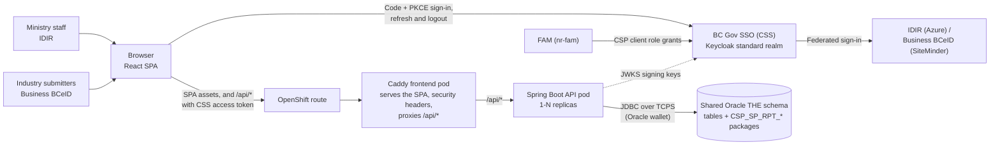
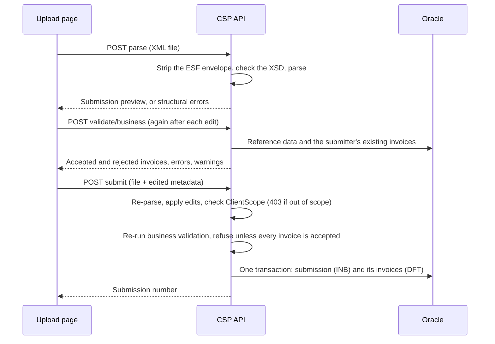
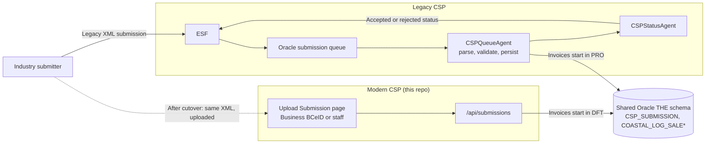
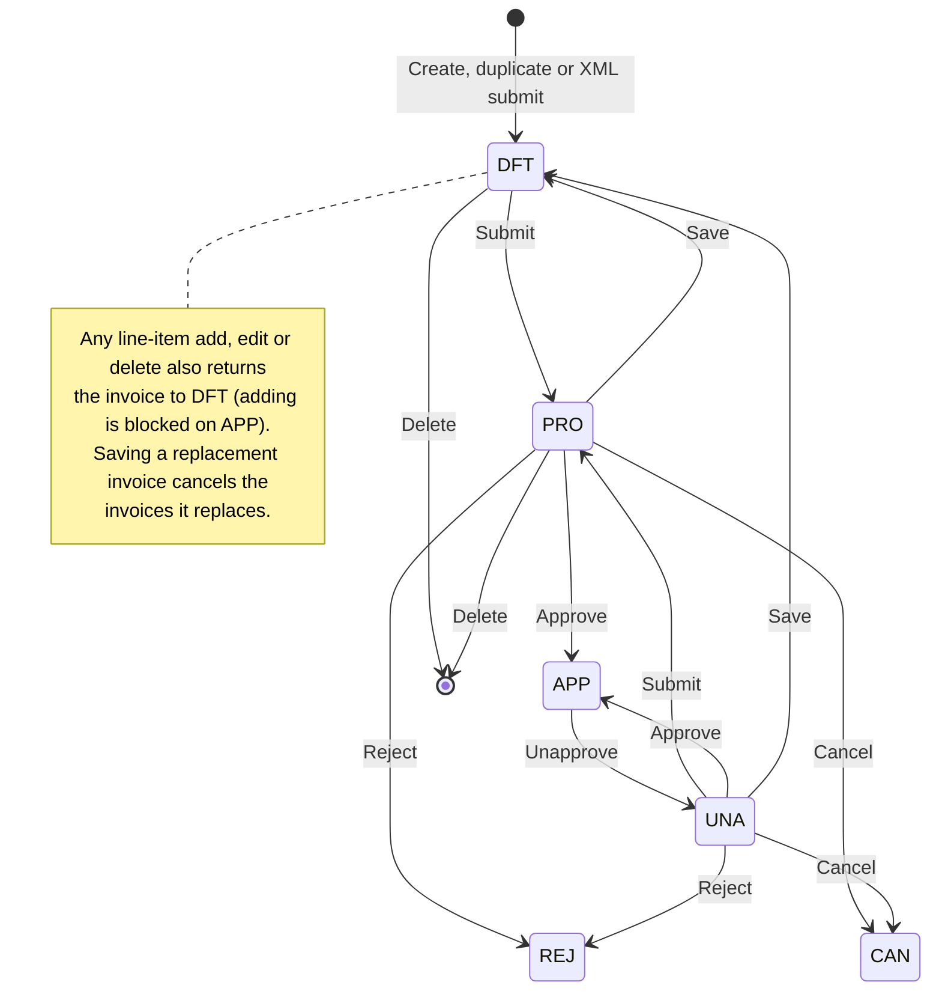
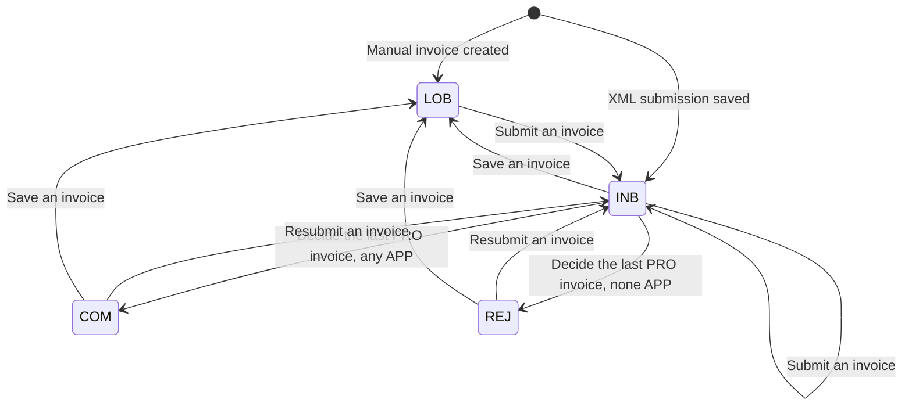
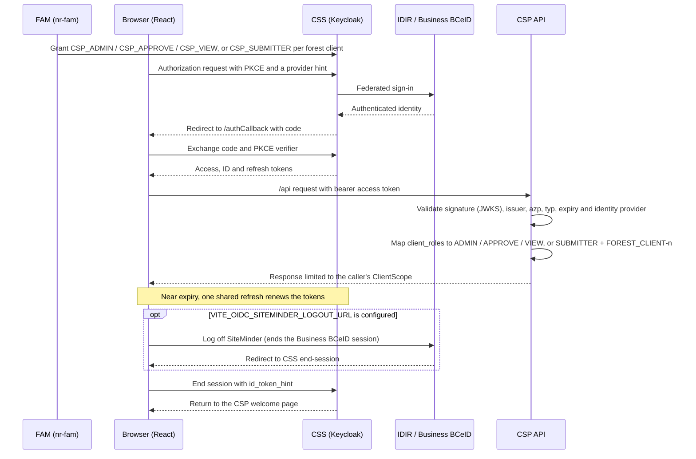
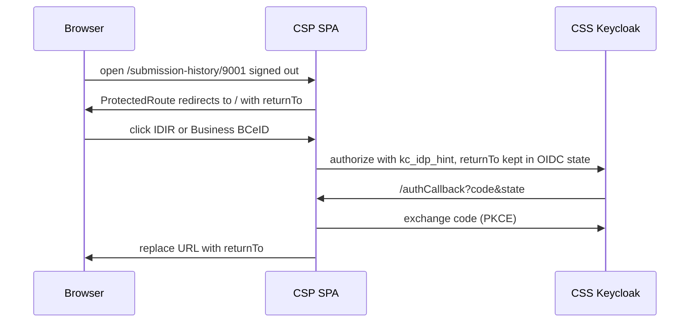
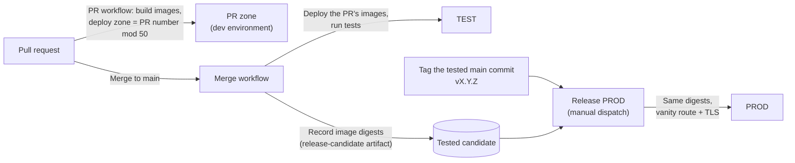

# Architecture

How the **Coast Selling Price (CSP) System** is put together, and why. For setup and
day-to-day commands see [README.md](README.md); for security reporting and controls see
[SECURITY.md](SECURITY.md); for end-to-end testing see
[`frontend/e2e/README.md`](frontend/e2e/README.md).

> `.github/graphics/architecture.svg` is left over from the bcgov quickstart template. It
> depicts a Node/Nest API with Postgres and does **not** describe this system.

- [System overview](#system-overview)
- [Tech stack](#tech-stack)
- [Backend](#backend)
- [Data access: why there is no JPA](#data-access-why-there-is-no-jpa)
- [Invoice domain](#invoice-domain)
- [Reporting pipeline](#reporting-pipeline)
- [Caching and cold start](#caching-and-cold-start)
- [Frontend](#frontend)
- [Authentication and authorization](#authentication-and-authorization)
- [Runtime configuration](#runtime-configuration)
- [Deployment topology](#deployment-topology)
- [Testing strategy](#testing-strategy)
- [Notable constraints](#notable-constraints)

## System overview



The backend validates CSS tokens statelessly, enforces action-level `@PreAuthorize` rules, runs
the invoice domain (XML uploads and manual entry), fills JasperReports designs as PDF, CSV or
XLS, and caches reference data in Caffeine. Legacy CSP uses the same Oracle schema; see
[Legacy and modern XML intake](#legacy-and-modern-xml-intake).

The backend is **never exposed directly**. In OpenShift and in local compose alike, all traffic
enters through the frontend, which proxies `/api/*`. There is one consequence worth knowing:
TLS terminates at the OpenShift edge router, so the backend only ever sees plain HTTP and its
Spring HSTS config never fires. HSTS is therefore set at the Caddy layer instead, covering both
static responses and proxied API responses.

## Tech stack

**Backend**

| Component | Choice | Notes |
|---|---|---|
| Language | Java 21 | Builds on JDK 21, runs on a JRE 25 base image |
| Framework | Spring Boot 4.1 | Web MVC, Security, Validation, Cache, JDBC |
| Build | Maven | Surefire (unit) + Failsafe (`*IT.java`) + JaCoCo |
| Database | Oracle | `ojdbc11`, HikariCP, TCPS with an Oracle wallet |
| Data access | Spring `JdbcTemplate` | **No JPA/Hibernate** — see below |
| Logging | Log4j2 | Replaces Spring's default Logback starter throughout |
| API docs | springdoc-openapi | Swagger UI at `/api/swagger-ui.html`, local development only (`API_DOCS_ENABLED`) |
| Auth | jjwt + `jwks-rsa` | CSS access-token validation against the configured realm's JWKS |
| Caching | Caffeine | 11 reference-data caches, 12-hour TTL |
| Mapping | MapStruct | DTO ↔ domain mapping |
| Reporting | JasperReports | `.jrxml` designs; OpenPDF for PDF, Apache POI for XLS |
| XML | JAXB + XSD | ESF submission parsing and schema validation |
| Boilerplate | Lombok | |

**Frontend**

| Component | Choice | Notes |
|---|---|---|
| Language | TypeScript 6 | |
| Framework | React 19 | |
| Build | Vite 8 | Dev server proxies `/api` to `:8080` |
| UI | IBM Carbon + `@bcgov-nr/nr-theme` | BC Gov design system on Carbon |
| Routing | React Router 8 | |
| Server state | TanStack React Query 5 | |
| HTTP | Axios | |
| Auth | `oidc-client-ts` 3.5 | Public-client PKCE login through CSS Keycloak |
| Styling | Sass | |
| PWA | `vite-plugin-pwa` | Service worker, auto-update |
| Testing | Vitest 5 | Two projects: happy-dom and real Chromium |
| E2E | Playwright + playwright-bdd | Nested project in `frontend/e2e/` |
| Serving | Caddy 2 | Production static server |

## Backend

Layered, with the invoice domain pulled out of the generic layers:

```
controller/   REST controllers; `api/` holds the OpenAPI-annotated interfaces they implement
service/      Business logic, reporting, MapStruct mappers, domain models
repository/   JdbcTemplate data access + row mappers
invoice/      The invoice domain (see below)
config/       Security, cache, datasource, Jackson, Jasper, OpenAPI, clock
filter/       JwtRequestFilter and MockRequestFilter
exception/    Domain exceptions + the global handler
util/         Constants (roles, permissions) and validation helpers
```

Controllers are split into an interface (`controller/api/*Api.java`) carrying the OpenAPI
annotations and an implementation (`controller/*Controller.java`) carrying the logic and the
`@PreAuthorize` rules. This keeps the generated API docs readable and the controllers short.

`ClockConfig` injects a `Clock` bean fixed to the business zone **America/Vancouver**, rather
than letting code call `LocalDate.now()` directly — so date-sensitive business rules are
testable without freezing system time, and don't shift with the container's timezone.

### API surface

Everything is under `/api`. With `API_DOCS_ENABLED=true` (local development only) the OpenAPI
document is at `/api/v3/api-docs` and Swagger UI at `/api/swagger-ui/index.html`, for staff roles.
Deployed environments don't serve either; `/api/health` is the only unauthenticated endpoint.

| Area | Path | Notes |
|---|---|---|
| Health | `GET /api/health` | Returns a hardcoded `UP`. **It does not check the database** — and it is the liveness probe, so a pod with a dead DB still reports healthy |
| Search / clients | `GET /api/search`, `/api/clients` | Paged invoice search and client lookup |
| Inbox | `GET /api/inbox` | The current user's review queue |
| Invoices | `/api/invoices` | CRUD, submit, duplicate, status changes, line items, CSV/PDF export |
| Electronic submissions | `/api/submissions` | Multipart XML: `validate/structural`, `parse`, `validate/business`, `submit` |
| Submission history | `/api/submission-history[/{id}]` | Past submissions and their invoices |
| Sort codes | `/api/sort-codes` | CRUD plus PDF/CSV export |
| Flat price conversions | `/api/flat-price-conversions` | CRUD, copy, clear (all audited), plus PDF/CSV export |
| Lookups | `/api/lookup/*` | Reference code tables |
| Reports | `POST /api/R06` … `/api/R13` | PDF or CSV per request |

Only **write** endpoints carry `@PreAuthorize`. Read, report, search, lookup, and submission
endpoints require authentication but no specific role.

## Data access: why there is no JPA

This is the single most surprising thing about the backend, and the thing most likely to trip
up someone arriving from a typical Spring project.

**There are no JPA entities, no Hibernate, and no Spring Data repositories.** The
`repository/` classes are hand-written and wrap `NamedParameterJdbcTemplate`, issuing SQL
directly against the `THE` schema or calling PL/SQL packages.

The reason is the legacy database. CSP sits on a long-established Ministry of Forests Oracle
schema whose business logic lives in PL/SQL packages that return **REF CURSORs**. Those are the
contract — reimplementing them as ORM mappings would mean duplicating logic that already exists
and is relied on elsewhere. So the application calls them and maps the results.

Two custom classes exist purely to make JasperReports cooperate with that decision:

- **`PlsqlQueryExecuterFactory`** — JasperReports' compile-time verifier checks every `$P{...}`
  used in a query against an allow-list of 19 primitive/date/String types. `java.sql.ResultSet`
  isn't on it, so a report declaring a `REPORT_CURSOR` parameter — the standard shape for an
  Oracle stored procedure returning a REF CURSOR — fails to compile with "Parameter type not
  supported in query". This factory relaxes only that check.
- **`RefCursorProcedureCallHandlerFactory`** — relaxing the compile-time check isn't enough.
  JasperReports' own `OracleProcedureCallHandlerFactory`, despite the name, is dead code in the
  open-source jar: it reflectively loads a class that doesn't exist and silently returns `null`.
  This supplies the runtime REF CURSOR binding it was supposed to provide.

Both are registered for the `plsql` query language in `jasperreports.properties`, because the
R06–R13 designs were authored for JasperReports **Server**, which bundles `plsql` support as a
commercial extension absent from the open-source library.

`ValidatingDataSource` wraps the pool and runs `SELECT 1 FROM DUAL` from its constructor, so a
misconfigured or unreachable datasource fails at **startup** rather than on first query. This
applies on every profile, `local` included — see the note in [README.md](README.md) about
neither profile booting without a database.

`spring-data-commons` is on the classpath only for `Page`, `Pageable` and `Sort`; it is not
Spring Data JPA. Transactions are declared with `@Transactional` on service methods. The main
tables are `COASTAL_LOG_SALE*`, `CSP_SUBMISSION`, `ELECTRONIC_SUBMISSION`, `LOG_SALE_SORT_CODE`,
`LOG_SALE_FLAT_PRICE_CONVERSION` (with an `_AUD` audit table), `CSP_SPECIES_GRADE_XREF`, plus
client views and code tables.

Most report templates call the Oracle stored procedures `CSP_SP_RPT_*` directly via
`<query language="plsql">{call …}`. **R13 (ad hoc) is the exception** — it uses plain SQL and
adjusts its columns at runtime with dom4j.

## Invoice domain

Invoices arrive through two channels, deliberately kept as separate orchestrators:

```
invoice/
  submission/        Electronic (uploaded ESF-format XML)
    structural/      Parsing and XSD schema validation
      parser/        SubmissionXmlParser
      schema/        SchemaValidator (schemas/csp/mof-csp.xsd)
    business/        Business-rule validation
      rule/
        submission/  Submission-level rules
        invoice/     Invoice-level rules
        line/        Line-item-level rules
      referencedata/ Reference data the rules need
      support/       Shared rule helpers
  manual/            Manually keyed invoices (CRUD through the UI)
  shared/            Channel-agnostic models and rules
```

Validation runs in two stages: **structural** first (does this parse, and does it satisfy the
XSD?), then **business** (do the values make sense against reference data and the rulebook?).
The submission hierarchy is fixed by the schema — one submission, one submitter client, one or
more invoices, each with one or more line items.

The validation pipeline is written to be application-agnostic; everything CSP-specific is
configuration, declared under `csp.submission.validation` in `application.yml` (schema paths,
JAXB context path, envelope and body namespaces and root elements) and defaulted in
`SubmissionValidationProperties`.

> **Known duplication.** Some invariant invoice rules are currently implemented twice — once
> on the electronic path, once on the manual path — and have drifted. A planned refactor to
> extract a shared pure rule core is documented in
> [`docs/refactor-shared-invoice-rules.md`](docs/refactor-shared-invoice-rules.md). The full
> rulebook ported from the legacy app is in
> [`docs/submission-validation-business-rules.md`](docs/submission-validation-business-rules.md).

### XML upload pipeline

The Upload Submission page walks a file through the `/api/submissions` endpoints. `parse`
runs the structural checks itself, so the page never calls the standalone `validate/structural`.
`submit` re-parses the file rather than trusting earlier steps, so what was validated is what
gets saved.



### Legacy and modern XML intake

Legacy CSP pulls industry XML from ESF through an Oracle queue and reports status back to ESF.
Modern CSP has no queue reader: submitters upload the same ESF-format XML in the app and
follow it in Submission History. Both apps write the same tables, so legacy keeps importing
ESF submissions for as long as it runs.



### Invoice and submission status

An invoice's status decides which actions the Invoice page offers. Codes are the
`INVENTRYSTATUS_*` constants.



Each invoice belongs to a `CSP_SUBMISSION`. Invoice actions set the submission's status
directly; it is not recalculated from its invoices otherwise:



Save, or a line-item change on an invoice that isn't DFT, sets LOB. Submit sets INB. Approve,
Reject and Cancel ("decide") set COM or REJ once no PRO invoices remain, and otherwise leave the
submission alone. Unapprove and Duplicate never change it. An uploaded submission starts in INB
with every invoice still DFT, so each invoice is submitted (the submission stays INB) before any
can be decided.

Reject, Cancel and Unapprove need a changed reviewer comment, and the user who entered an
invoice can't approve it.

## Reporting pipeline

Seven reports — R06, R07, R08, R10, R11, R12, R13 (there is no R09) — each with a `.jrxml` design in
`backend/src/main/resources/reports/`, plus a `_CSV` variant and subreports where needed. Each
has a controller (`R06Api`…`R13Api`), a service, and a frontend page.

A report request flows: controller → service → PL/SQL call returning a REF CURSOR → Jasper
fills the design → export as **PDF** (OpenPDF), **CSV** (the `_CSV` design variant), or **XLS**
(Apache POI).

Font handling is explicit: `fonts.xml` and `jasperreports_extension.properties` register the
font extensions Jasper needs, and ICU4J backs text layout. Without these, PDF output falls back
to substituted fonts and the layouts shift.

## Caching and cold start

Reference data — species, grades, sort codes, invoice and submission statuses, maturity codes,
FOB codes, modelling codes, species/grade combinations — is small, changes rarely, and was
being queried on demand. `CacheConfig` defines 11 Caffeine caches with a 12-hour TTL and a
1,000-entry ceiling.

Caching alone doesn't help the *first* request into a fresh pod, so
`ReferenceDataWarmupService` implements `ApplicationRunner` and populates every cache at
startup, including the per-species grade lists so the first filtered dropdown is warm too.

The reasoning and measurements are in
[`docs/investigations/reference-data-cold-start.md`](docs/investigations/reference-data-cold-start.md).

## Frontend

```
src/
  pages/        One folder per route — 17 pages
  components/
    Form/       Carbon-based inputs: autocompletes, multi-selects, editable tables
    Layout/     Header, side nav, profile panel, theme toggle, mock role selector
    core/       Modals, tables, tags, empty/loading states, file drop zone
  context/      auth, theme, layout, notification, pageTitle providers
  config/       API client, FAM config, React Query defaults, test setup
  hooks/        Shared hooks
  utils/        Shared helpers
```

Routes map to the domain: `Search`, `SubmissionHistory` (list and detail),
`UploadSubmission`, `Inbox`, `Invoice` (list and detail), `SortCode`, `FlatPriceConversion`,
the seven report pages, plus `Welcome`, `NotFound`, and a `/logout` route that immediately
redirects to the welcome screen.

**Server state is React Query's job**; component state is not used as a cache. Defaults are
deliberately quiet for a low-churn internal app — 3-hour `staleTime` and `gcTime`, no refetch
on window focus, no retry (`config/react-query/config.ts`). Table and search state persist in
`sessionStorage` via `usePersistentState`. There is no Redux or other global store.

**The axios client** (`config/api/request.ts`) uses `baseURL: '/api'` and a 60-second timeout.
A `401` from the backend or an expired/revoked refresh token triggers sign-out. Temporary
SSO/network renewal failures preserve credentials so the session can recover.

> **No types are generated from OpenAPI.** Each `services/*.service.ts` hand-writes its
> TypeScript types alongside the React Query hooks, so a backend DTO change has to be mirrored
> by hand. Nothing fails at build time if you forget.

The auth provider is chosen at runtime — `AuthProvider` returns a mock provider or the real
OIDC one depending on `env.mockUser`. Mock auth requires both the runtime opt-in and a local
hostname; deployed configuration disables it.

The PWA service worker uses a `navigateFallbackDenylist` for `/^\/api\//`. Without it, Workbox
applies the SPA navigation fallback to API navigations and serves the React shell when you open
Swagger UI.

## Authentication and authorization



**Sign-in.** `oidc-client-ts` uses authorization code with PKCE against a public CSS Keycloak
client, with roles managed in FAM. OIDC user/state data lives in tab-scoped `sessionStorage`.
IDIR MFA and Business BCeID use provider hints; login alone does not grant application access.
The SPA handles `/authCallback`, restores a same-origin application route, and sends the access
token as a bearer token on every `/api` call.

**Signed-out deep links.** `ProtectedRoute` redirects a signed-out visitor to the welcome page
at `/`, passing the requested path, query and hash as `returnTo` in router state. The chosen
provider button starts sign-in with that `returnTo` saved in local OIDC state, and
`getOidcReturnPath` restores it on `/authCallback` only when it is a same-origin route.



**Token validation.** The backend is stateless — no sessions, no CSRF token (there is no
browser-automatable credential to exploit, since the credential is an `Authorization` header on
a stateless request). `JwtRequestFilter` and `JwtService` use `jwks-rsa` and jjwt to validate
the CSS realm's RS256 signature, exact issuer and `azp`, `typ=Bearer`, expiry, supported
identity provider, and directory username for auditing. Real auth requires
`CSP_OIDC_ISSUER_URI` and `CSP_OIDC_CLIENT_ID`; the JWKS URI is derived from the issuer unless
`CSP_OIDC_JWKS_URI` overrides it. `/api/health` is the only public path; the upload
and submission-history endpoints admit an internal `ADMIN`, `APPROVE`, `VIEW` or `SUBMITTER`
authority, and all other `/api/**` requests require `ADMIN`, `APPROVE`, or `VIEW`.

**Mock auth.** `MockRequestFilter` is registered only when `auth.mock.enabled` is true and
installs a synthetic authentication from `AUTH_MOCK_IDENTITY_PROVIDER` and `AUTH_MOCK_ROLES`, or
from the identity the local UI's mock role selector sends, mapped by the same `CspAuthorities` as
real tokens. It is an
`Optional<MockRequestFilter>` injection, so when mock auth is off the filter does not exist in
the context at all.

**Role and action checks.** Internal roles are `ADMIN`, `APPROVE`, `VIEW`, and `SUBMITTER`, held
as plain authorities with no `ROLE_` prefix; a submitter also holds one `FOREST_CLIENT-<number>`
authority per client. CSS roles come from `client_roles`, falling back only to
`resource_access.<configured client>.roles`, and match exactly but case-insensitively.
`CSP_ADMIN`, `CSP_APPROVE`, and `CSP_VIEW` grant the staff authority to IDIR/IDIR MFA identities
only.
`CSP_SUBMITTER_FOREST_CLIENT-<8 digits>`, which FAM issues once per forest client for a
forest-client-scoped role, grants `SUBMITTER` to Business BCeID identities only; it is parsed
the way FAM's `CssRoleNaming.parse` does. Bare roles, suffix aliases, foreign roles, `FAM:`
bookkeeping roles and other identity providers grant none. Backend `CspAuthorities` and frontend
`famRoles.ts` implement this mapping; the API enforces it.

`ClientScope` is the forest-client boundary: every client for staff, the held clients for a
submitter, and never an empty list. Submission validate/submit refuse with 403, before the
business rules (which look up the submitting party's invoices), when the submission client or
any invoice's submitting party is out of scope, and every submission-history query adds `sub.client_number IN (:clientNumbers)` for a submitter.

Controllers declare a specific action string from the FAM permission matrix:

```java
@PreAuthorize("@permissionService.hasPermission(authentication, 'invoiceDetails/Approve')")
```

`PermissionConstants.ROLE_PERMISSIONS` maps each role to its set of permitted actions, and
`PermissionService` evaluates the SpEL. The frontend mirrors the same catalogue in
`context/auth/permissions.ts` to decide which buttons to render — **the two must be kept in
sync**; the backend is the enforcement point and the frontend is only a UX affordance.

**Session lifecycle.** `service/oidc-service.ts` shares one refresh operation between API
requests and user activity, avoiding concurrent use of a rotating refresh token. Logout reads
the ID-token hint before clearing local credentials, then redirects through the configured CSS
realm back to `/`. When `VITE_OIDC_SITEMINDER_LOGOUT_URL` is set it logs off SiteMinder first,
because ending the Keycloak session doesn't end the SiteMinder session behind Business BCeID. There is no legacy broker popup. The app retains its
30-minute inactivity limit and cross-tab activity/logout messages; temporary SSO/network
renewal failures preserve the session, while expired/revoked refresh tokens end it.

## Runtime configuration

Nothing environment-specific is baked into the frontend build. The SPA reads
`window.appConfig` from `public/config.js` at runtime:

- **In OpenShift** — a ConfigMap defined in `common/openshift.init.yml` is mounted over
  `/usr/share/caddy/config.js`. Changing CSS values needs a rollout, not a rebuild.
  This template is the canonical definition of the key set.
- **Locally** — `public/config.js` is a tracked, empty placeholder, and a localhost origin uses
  mock auth until CSS is configured. For real DEV login, set `VITE_OIDC_ISSUER_URI` and
  `VITE_OIDC_CLIENT_ID` in the git-ignored `frontend/.env` (see `frontend/.env.example`) and
  disable backend mock auth. Callback and logout URLs are computed from the current browser
  origin. These are public browser settings; never store credentials or commit machine-specific
  overrides.

The ConfigMap is created in the **init** step rather than the deploy template, because that is
where environment-scoped GitHub variables resolve correctly. `CSP_OIDC_ISSUER_URI` and
`CSP_OIDC_CLIENT_ID` are variables in each of `dev`, `test`, and `prod`, not secrets. No new
browser secret is required.

The backend is configured by Spring profiles in `application.yml`: `local` (empty fallbacks,
mock auth on, DEBUG logging) and `prod` (every value required, injected as env vars). Hikari
pool settings are tuned for the OpenShift→Oracle network path — `keepalive-time` pings idle
connections so firewalls can't silently drop them, and `max-lifetime` recycles well inside any
server-side idle limit.

## Deployment topology

Each deployment gets its own **zone**: `test`, `prod`, or — for PR environments — the **PR
number mod 50**. Every object name carries the zone, so environments are isolated. PR zones run
lite: one replica, no HPA or PDB. Two deployments per zone:

**Frontend pod** — Caddy on port 3000, serving static files and proxying `/api/*`. The
`caddy:2-alpine` image ships `CAP_NET_BIND_SERVICE` as a file capability on the binary;
OpenShift's restricted SCC refuses to exec a binary with file capabilities when
`allowPrivilegeEscalation=false`, so the Dockerfile strips it. The app listens on 3000, so the
capability was never needed.

**Backend pod** — an **init container** (`ghcr.io/bcgov/nr-forest-client/common:prod`) runs
first, connecting to Oracle on port 1543 (TCPS) with `KEYSTORE_SECRET` to fetch an Oracle
wallet and write it into a shared `/cert` volume. The main container mounts that volume and its
entrypoint merges the wallet certificate into the JVM trust store before the app starts. This
is why the JDBC URL must use the TCPS descriptor form: the short form bypasses the wallet.

**Pod hardening.** Both deployments run non-root with `readOnlyRootFilesystem: true`, all
capabilities dropped (`drop: ["ALL"]`), and `automountServiceAccountToken: false`.

**Network isolation.** NetworkPolicies in `common/openshift.init.yml` allow ingress to the
frontend only from the OpenShift router, and to the backend only from frontend pods **in the
same zone** plus the cluster monitoring namespace. The backend has no Route of its own, so it
is unreachable from outside the namespace — which is also why there is no CORS configuration
anywhere: the SPA and the API share an origin.

**Ordering.** `common/openshift.init.yml` is applied first and creates the Secrets, ConfigMaps
(including `config.js`) and NetworkPolicies; the two deploy templates follow.

Image rollout differs by zone. PR deploys pass the immutable head SHA as the image tag, so
every push changes the pod spec and forces a rollout. Test and prod use the mutable PR-number
tag, where `oc apply` would see an unchanged Deployment and keep serving a stale image despite
`imagePullPolicy: Always` — so a commit stamp on the pod template forces the rollout instead.

### Release flow

PROD never builds its own images. It promotes the exact image digests that passed TEST.



`Release PROD` refuses a tag whose commit has no successful TEST run. The Merge workflow ignores
root-level Markdown files (`*.md`) and `.github/graphics/**`, so a merge that changes only those
doesn't redeploy TEST. Markdown under `docs/` or elsewhere still does.

## Testing strategy

| Layer | Tool | Scope |
|---|---|---|
| Backend unit | JUnit 5 + Mockito (Surefire) | Services, rules, mappers |
| Backend integration | Failsafe + Testcontainers (`gvenzl/oracle-free`), bootstrapped by `db/test-bootstrap.sql` (creates the `THE` schema, seed data, and stub `CSP_SP_RPT_*` procedures) | `*IT.java` — controllers and reports against a real Oracle. Skipped when Docker isn't available |
| Frontend unit | Vitest, happy-dom | `*.unit.test.{ts,tsx}` |
| Frontend component | Vitest, real Chromium | `*.browser.test.{ts,tsx}` — opt-in via `VITEST_BROWSER_ENABLED` |
| API integration | Node suite in `common/tests/integration` | Run against a deployed zone in CI |
| End-to-end | Playwright + playwright-bdd | `frontend/e2e/` — Gherkin features against the full stack |

Coverage is reported to SonarCloud per component. The backend merges unit and integration
coverage into a single JaCoCo report so integration-only code paths aren't reported as
uncovered.

The e2e suite deserves a specific note: `.feature` files are the executable specification,
re-grounded from each use case's legacy Gherkin onto the current app's routes, fields, and
seeded data. Scenarios tagged `@discovered-divergence` track **confirmed application defects**
and fail on purpose — they are excluded from the default `npm test` so its exit status stays
meaningful, and run separately via `npm run test:divergences`. See
[`frontend/e2e/README.md`](frontend/e2e/README.md).

## Known quirks and technical debt

Things that are genuinely worth fixing or confirming:

- **Local dev needs a real DB and a JWKS URL.** `ValidatingDataSource` and `JwtService` both
  fail at startup when these are missing, on every profile — the `local` profile's "empty
  fallbacks" do not make the app self-contained.
- **Role names in `.env.example` were wrong** (now fixed): it listed `CSP_VIEWER` /
  `CSP_SUBMITTER` / `CSP_APPROVER`, but the code matches `_VIEW`, `_APPROVE`, `_ADMIN`.
  Someone should still confirm which group names FAM actually issues.
- **Read endpoints have no action-level check.** Staff read endpoints rely on the `/api/**`
  staff-role rule; only write endpoints and the industry-capable submission endpoints declare an
  action. In the UI, each route's page action (`routes/access.ts`) gates `ProtectedRoute` and the
  side nav.
- **Unused serving certificate.** The backend Service requests an OpenShift serving cert and
  mounts it at `/etc/tls-certs`, but the app serves plain HTTP on 8080 and never reads it.
- **Java 21 compile, JRE 25 runtime.** `backend/Dockerfile` builds on Temurin 21 and runs on a
  JRE 25 base; bytecode targets 21.
- **Invoice status rules live only in the UI.** The API accepts Approve, Reject, Cancel and
  Unapprove from any status, and Delete from any status but APP. Only the Invoice page limits
  them to the transitions in [Invoice and submission status](#invoice-and-submission-status).
- **Uploaded XML invoices start in DFT.** Legacy ESF intake started them in PRO, ready for
  review. Which one the business wants is still open.
- **`/api/health` doesn't check anything.** It returns a hardcoded `UP` and is wired as the
  liveness probe, so a pod with an unreachable database still reports healthy.
- **Stale comments and template leftovers:**
  - `docs/investigations/reference-data-cold-start.md` describes `ConcurrentMapCacheManager`;
    the code has since moved to Caffeine.
  - `frontend/openshift.deploy.yml`'s header says config is baked into the image; it is
    injected at runtime.
  - `.github/graphics/*` (the architecture SVG shows Node/Postgres), the SchemaSpy job, and
    `API_NAME: nest` in `reusable-tests.yml` are all quickstart-template leftovers.

## Notable constraints

Things that look like mistakes but are deliberate:

- **No JPA.** Hand-written `JdbcTemplate` repositories over PL/SQL REF CURSORs. See above.
- **Two custom Jasper classes** exist to work around dead code and an over-strict verifier in
  the open-source JasperReports jar.
- **Log4j2 replaces Logback**, with the default starter excluded from every Spring dependency.
- **CSRF is disabled** — correct for a stateless bearer-token API with no session cookie.
- **HSTS is set at Caddy, not Spring**, because TLS terminates at the edge router.
- **`@playwright/test` is pinned exactly** in the e2e project; the reason is in its README.
- **The Vitest browser project is opt-in**, because Vitest initialises the Playwright provider
  at startup otherwise, triggering an unwanted Chromium download.
- **The Vite dev server ignores `e2e/` subpaths** when watching, or the nested e2e project's
  artifacts trigger full page reloads and a rescan of thousands of irrelevant files.
