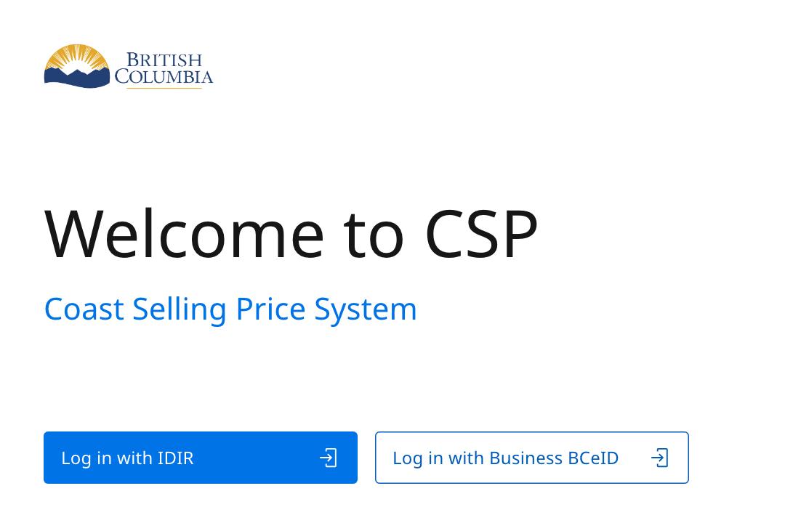
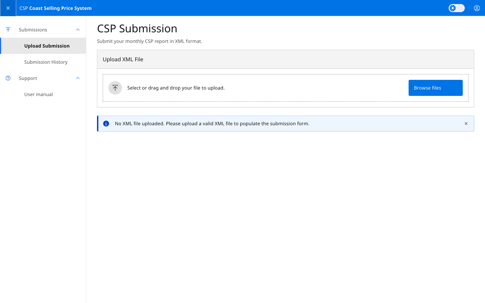
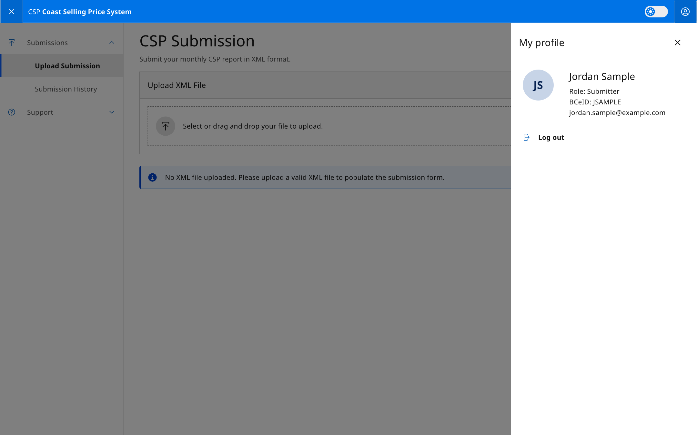

# 1. Getting started

CSP collects the coastal log sale invoices that sellers and buyers report to
the ministry. As an industry user you have the **Submitter** role: you upload
your invoices as an XML file and follow what happens to them.

## Screens

| Menu item | Use it to |
|---|---|
| **Submissions › Upload Submission** | Upload an XML file of invoices, check it and submit it. |
| **Submissions › Submission History** | See the files you have submitted, their status and staff comments. |
| **Support › User manual** | Download this manual. |

## Your access

Your access is granted for each forest client you submit for. You can submit
invoices, and see submissions, only for those clients. If you need to submit
for another client, contact the CSP application administrator.

## Common tasks

### Log in

1. Open CSP.
2. Select **Log in with Business BCeID** and sign in with your Business BCeID
   user ID and password.
3. CSP opens **Upload Submission**.

If you open a link to a CSP page while logged out, CSP asks you to log in
first and then takes you to that page.

If your account has no CSP role, CSP shows **No CSP access** and a **Sign
out** button. Contact the CSP application administrator to get access.

### Find your way around

The menu on the left lists the screens you can use. Select a group, such as
**Submissions**, to open it. The button at the top left hides and shows the
menu. Select **CSP Coast Selling Price System** in the header to return to
**Upload Submission**.

The switch in the header turns on the **Dark theme**. CSP goes back to the
light theme when you reload the page.

### See your profile and log out

1. Select the profile icon at the top right (**User settings**).
2. **My profile** shows your name, **Role: Submitter**, your BCeID user ID and
   email address.
3. Select **Log out** to end your session.

### Work with lists

- Select a column heading to sort by it. Select it again to reverse the
  order, and a third time to remove the sort.
- Use the controls under a list to change how many rows show on a page and
  to move between pages.
- CSP remembers your sorting, page and open rows while the browser tab stays
  open, so you come back to the same place. Logging out clears them.
- Dates are written as year, month, day: `2026-11-04`.

## Session time-out

After 30 minutes with no activity, CSP logs you out. Activity in any open
CSP tab counts, and when one tab times out they all do. The welcome page then
shows **Your session has expired**. Anything you hadn't submitted is lost, so
upload the file again.
