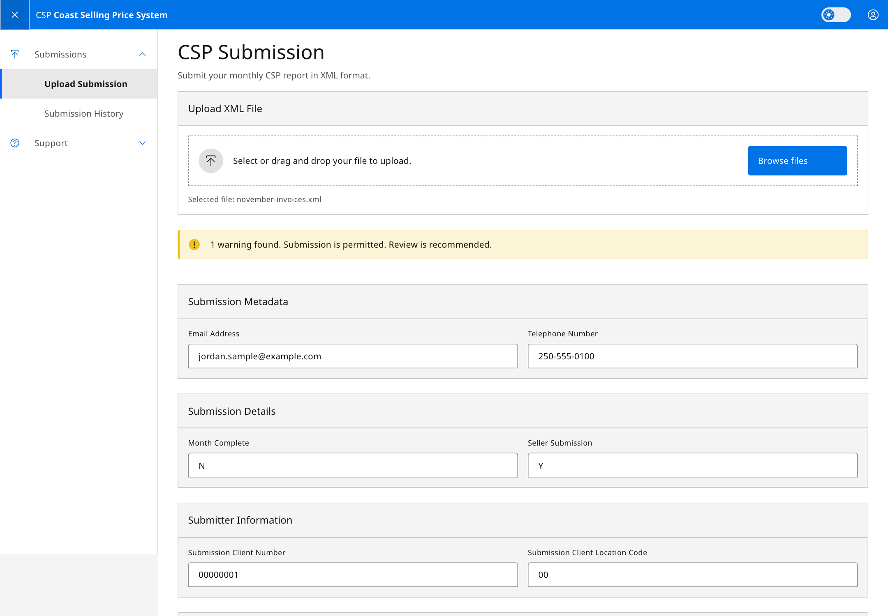
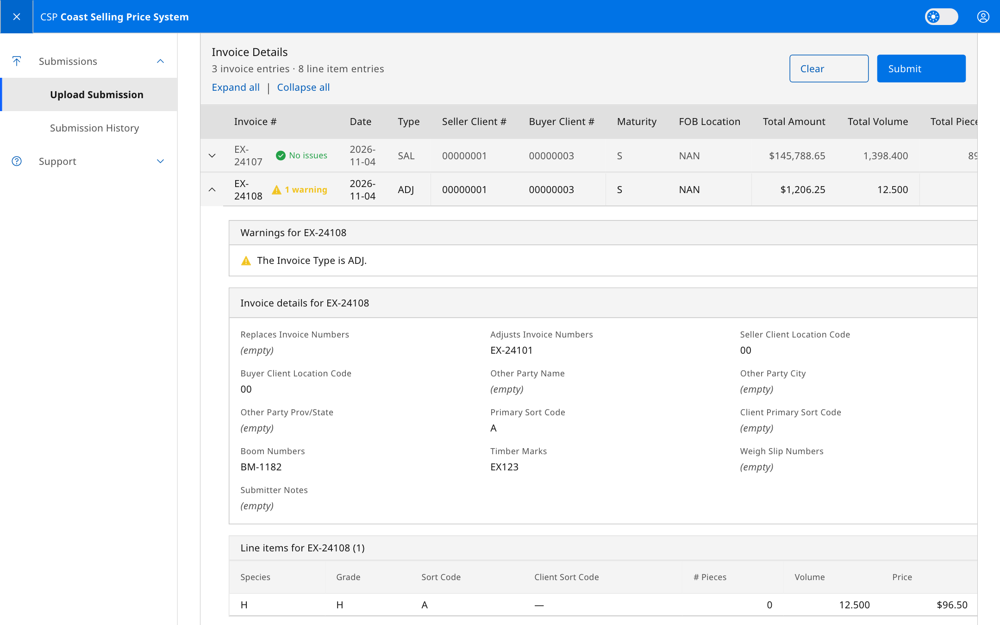
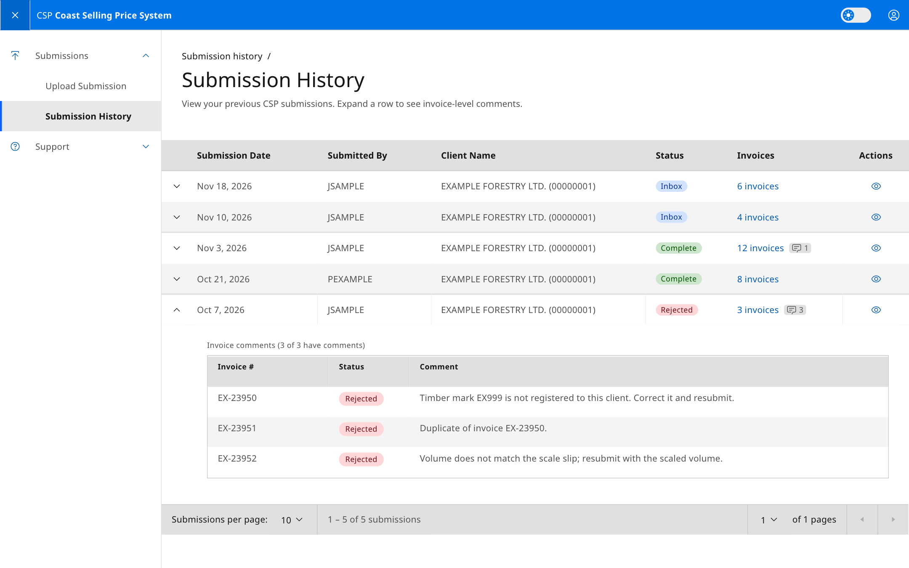
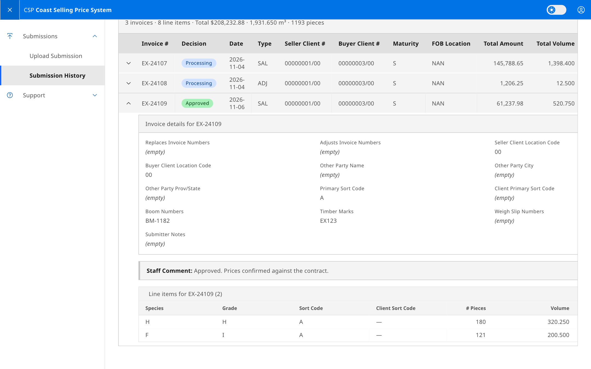

# 2. Submissions

A submission is one XML file of log sale invoices for one of your forest
clients. CSP checks the file as soon as you choose it, shows you what it
found, and saves it only when nothing in it is an error. Ministry staff then
review each invoice and approve or reject it.

## Screens

| Menu item | Use it to |
|---|---|
| **Submissions › Upload Submission** | Choose an XML file, review what CSP read from it and submit it. |
| **Submissions › Submission History** | Follow your submissions and read staff comments. |

## Your XML file

CSP reads the CSP submission XML format: a `CSPSubmission` with one
`CSPSubmitter` and one or more `CSPInvoice` elements. A file wrapped in an
`ESFSubmission` envelope is also accepted; CSP then reads the contact email
and telephone number from the envelope. Elements must be in the order the
format sets out.

| Part | Must have | May have |
|---|---|---|
| Submitter | Seller submission (`Y` or `N`), submission client number and location code | |
| Each invoice | Invoice date, invoice number, invoice type, the invoice details and at least one line item | Invoice numbers it replaces or adjusts, seller and buyer client numbers and locations, the other party's name, city and province |
| Invoice details | Maturity, FOB location, total amount, total volume | Primary sort code, client primary sort code, total pieces, boom numbers, timber marks, weigh slip numbers, notes |
| Each line item | Secondary sort code, number of pieces, species, grade, volume, price | Client secondary sort code |

The rules that most often stop a file:

- The submission client number is 8 digits and the location code 2 digits,
  and the pair must be one of your forest clients.
- With **Seller submission** `Y` you are the seller: the submission client
  must be each invoice's seller, and an invoice can't be a purchase. With `N`
  you are the buyer, and an invoice can't be a sale.
- Identify the other party either by client number and location, or by name,
  city and province, not both.
- Each invoice needs at least one boom number, timber mark or weigh slip
  number, up to 10 of each.
- An invoice number has only uppercase letters, digits and hyphens, up to 15
  characters. An invoice can replace or adjust up to 5 others, but not both.
- An invoice date can't be in the future.
- Pieces must be more than zero, and volume and price can't be negative,
  except on an adjustment.

Totals that don't match the line items are warnings, not errors.

## Common tasks

### Upload and submit a file

1. **Submissions › Upload Submission**.
2. Select **Browse files** and choose your `.xml` file, or drag it onto the
   box.
3. CSP checks the file's structure, then its content against CSP's rules.
   This takes a few seconds.
4. Read the result at the top of the page:

   | Result | What it means |
   |---|---|
   | **… was uploaded with no issues found.** | Everything passed. |
   | **… warning(s) found.** | You can submit. Check the warnings first. |
   | **… error(s) found.** | **Submit** stays off. Correct the file and choose it again. |

5. Check the fields CSP read from the file. You can change **Email
   Address**, **Telephone Number**, **Month Complete**, **Seller Submission**,
   **Submission Client Number** and **Submission Client Location Code**. CSP
   re-checks your change and shows **Re-checking your changes…** while it
   does.
6. Under **Invoice Details**, each invoice shows **No issues** or the number of
   errors and warnings. Select the arrow beside an invoice to see its issues,
   its details and its line items.
7. Select **Submit**. CSP checks the file once more, saves it and opens the
   new submission. Its number is in the title, for example
   **Submission 1042**.

**Month Complete** must be `Y` or `N` before you submit; enter `Y` when this
file completes your reporting for the month. The invoices and line items
can't be changed on screen: correct them in your file.

Select **Clear** to start again with another file.

> **Tip:** CSP saves the whole file or none of it. If one invoice has an
> error, nothing is saved, so correct that invoice and upload the file again.

### Fix a file CSP can't read

If the file isn't valid XML in the CSP format, CSP shows **issue(s) found in
submission** and a **Validation issues** table instead of the form. Each row
gives the problem and where it is in the file (line and column).

1. Select **Download issues (.csv)** to keep the list.
2. Correct the file.
3. Select **Browse files** and choose the corrected file.

### Fix errors in a file

1. Look for invoices marked with errors under **Invoice Details**, and open
   them. The **Issues for** list names each problem, and a line item's problem
   starts with its line number. The fields involved are marked too; point at
   the mark to read the message.
2. If the error is on **Submission Client Number** or **Submission Client
   Location Code**, correct the field on screen.
3. Otherwise, correct the invoice in your file and choose the file again.

If you see **Submission client number must be one of your forest clients**
or **is not one of your forest clients**, the file is for a client your
access doesn't cover. See [Your access](01-getting-started.md#your-access).

### Check on a submission

1. **Submissions › Submission History**. The newest submission is at the top.
2. **Status** shows where the submission is. A speech bubble beside the
   invoice count means staff commented on some of its invoices.
3. Select the arrow at the start of a row to see each invoice's status and
   comment.
4. Select the invoice count, or the eye icon (**View submission**), to open
   the submission.

The list shows every submission for your forest clients, including ones made
by others in your organization.

### Read a submission and staff comments

The submission page shows the contact details, **Month Complete**, **Seller
Submission** and client from your file, and a table of its invoices. The
**Decision** column shows each invoice's status. Select the arrow beside an
invoice to see its details, line items and the **Staff Comment**.

Select **Back to Submission History** to return to the list.

### Correct a rejected invoice

1. Read the staff comment on the rejected invoice.
2. Correct the invoice in your system.
3. Upload it in a new file. If it replaces an invoice CSP already holds, give
   the corrected invoice a new invoice number and list the original's number
   in its replaced invoice numbers. An invoice can't replace itself: CSP
   refuses the whole file if one lists its own number.

## Statuses

A submission has one of these statuses.

| Status | Means |
|---|---|
| **Inbox** | Received and waiting for review. Every new submission starts here. |
| **Lobby** | Staff are working on one of its invoices. |
| **Complete** | Review is finished and at least one invoice was approved. |
| **Rejected** | Review is finished and no invoice was approved. |

The submission status is a summary: check each invoice's **Decision** to see
where it stands.

Each invoice has its own status, shown as its **Decision**.

| Status | Means |
|---|---|
| **Draft** | Received; review hasn't started. |
| **Processing** | Ministry staff are reviewing it. |
| **Approved** | Accepted. |
| **Rejected** | Not accepted. The staff comment says why. |
| **Cancelled** | Withdrawn, or replaced by another invoice. |
| **Unapproved** | An approval was reversed; staff review it again. |

Ministry staff review each invoice. When staff reject, cancel or unapprove an
invoice, they add a staff comment. An invoice cancelled because another one
replaced it has no comment.
