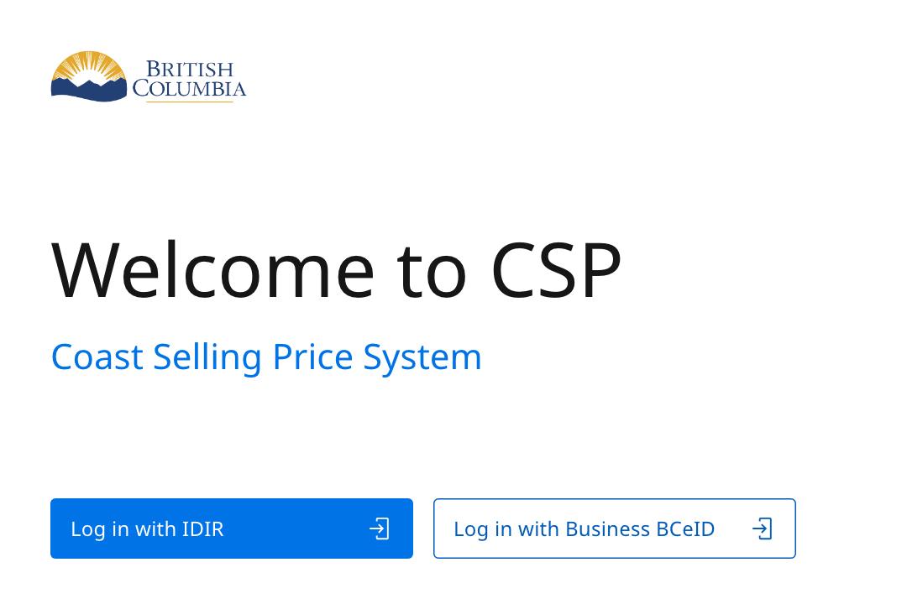
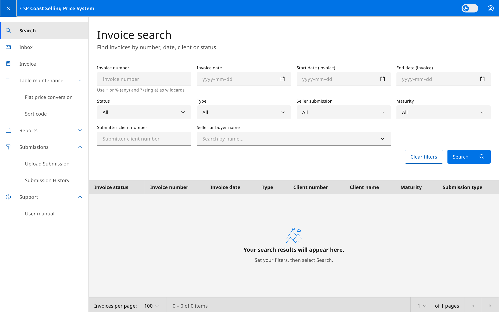
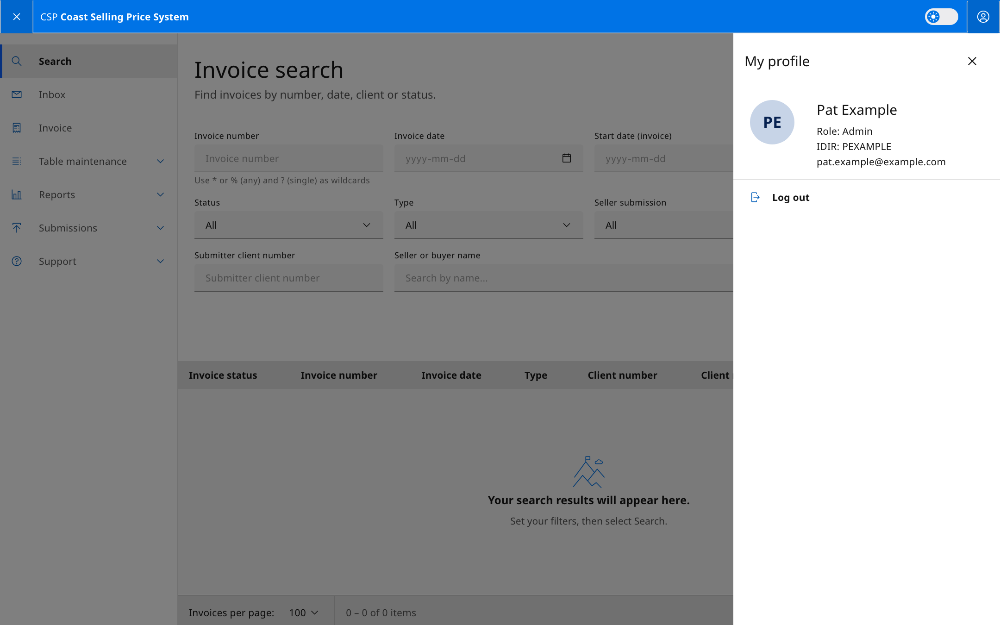

# 1. Getting started

CSP is where ministry staff find, enter and review coastal log sale invoices.
This chapter covers logging in, the menu and what works the same on every
screen.

## Screens

| Menu item | Use it to |
|---|---|
| **Search** | Find invoices. See [Search](02-search.md). |
| **Inbox** | Review submissions waiting for a decision. See [Inbox](03-inbox.md). | <!-- roles: admin, approver, viewer -->
| **Invoice** | Enter a manual invoice. See [Invoices](04-invoices.md). | <!-- roles: admin, approver, data-entry -->
| **Invoice** | Opens a blank invoice, which you can't save. Open invoices from **Search** instead. | <!-- roles: viewer -->
| **Table maintenance** | The flat price conversion and sort code tables. See [Table maintenance](05-table-maintenance.md). | <!-- roles: admin, approver, viewer -->
| **Reports** | Run reports R06 to R13. See [Reports](06-reports.md). | <!-- roles: admin, approver, viewer -->
| **Submissions** | Upload an XML file and see Submission History. See [Submissions](07-submissions.md). | <!-- roles: admin, approver, viewer -->
| **Support › User manual** | Download this manual. |

## Common tasks

### Log in

1. Open CSP.
2. Select **Log in with IDIR** and sign in with your IDIR.
3. CSP opens **Search** (**Invoice search**).

If you open a link to a CSP page while logged out, CSP asks you to log in
first and then takes you to that page. If your role can't open that page, you
land on **Invoice search** instead.

If your IDIR has no CSP role, CSP shows **No CSP access** and a **Sign out**
button. Ask the CSP application administrator for a role.

### Find your way around

The menu on the left lists the screens your role can use. Select a group,
such as **Support**, to open it. The button at the top left hides and shows
the menu. Select **CSP Coast Selling Price System** in the header to return
to **Invoice search**.

The switch in the header turns on the **Dark theme**. CSP goes back to the
light theme when you reload the page.

### See your profile and log out

1. Select the profile icon at the top right (**User settings**).
2. **My profile** shows your name, your role, your IDIR and email address. If
   you have more than one role, it shows the highest.
3. Select **Log out** to end your session.

### Search and work with results

Search pages share these controls.

- Fill in any filters and select **Search**, or press Enter in a field. No
  filter is required. **Clear filters** empties the filters and the results.
- In an invoice number filter, `*` or `%` matches any characters and `?`
  matches one.
- A client name field suggests clients after you type two letters. Choose
  one from the list.
- Dates are written as year, month, day (`2026-11-04`). Type them, or pick
  one from the calendar. A month field takes year and month (`2026-11`).
- After a search, **Search by keyword** narrows the results on the page.
- Select a column heading to sort by it. Select it again to reverse the
  order, and a third time to remove the sort.
- Use the controls under the results to change how many rows show on a page
  and to move between pages.
- CSP remembers your filters, results, sorting and page while the browser tab
  stays open, so you come back to the same results from an invoice. Logging
  out clears them.

Messages about a change you made show at the bottom right and close after a
few seconds. A red asterisk (\*) marks a required field.

## Session time-out

After 30 minutes with no activity, CSP logs you out. Activity in any open
CSP tab counts, and when one tab times out they all do. The welcome page then
shows **Your session has expired**. Changes you hadn't saved are lost, and
CSP doesn't warn you first, so save as you go.
