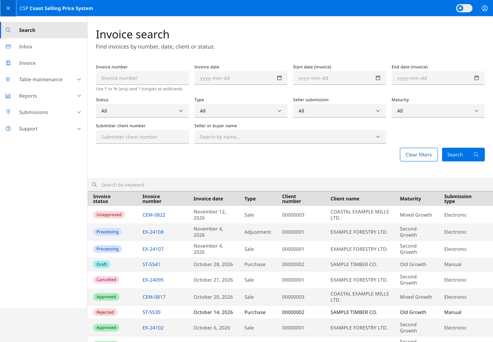

# 2. Search

**Invoice search** finds invoices, whether they arrived in an XML file or
were entered by staff, and opens them. It is the first screen you see after
logging in.

## Screens

| Menu item | Use it to |
|---|---|
| **Search** | Find invoices by number, date, client, status, type or maturity. |

## Common tasks

### Find an invoice

1. **Search**.
2. Fill in any of the filters:

   | Filter | Finds |
   |---|---|
   | **Invoice number** | Invoices whose number contains what you type. Use `*` or `%` for any characters and `?` for one. |
   | **Invoice date** | Invoices dated that day. |
   | **Start date (invoice)** and **End date (invoice)** | Invoices dated in that range, both days included. |
   | **Status** | Invoices with that status. See [Invoice statuses](04-invoices.md#invoice-statuses). |
   | **Type** | Sales, purchases, adjustments or cancellations. |
   | **Seller submission** | **Yes**: the seller reported it. **No**: the buyer did. |
   | **Maturity** | Old growth, second growth, mixed growth or cants. |
   | **Submitter client number** | Invoices reported by that client. Leading zeros are optional: `99` finds `00000099`. |
   | **Seller or buyer name** | Invoices where that client is the seller or the buyer. Type two letters and choose the client and location. |

3. Select **Search**.
4. Select an invoice number to open the invoice. See [Invoices](04-invoices.md).

The newest invoices are first. **Client number** and **Client name** are the
client that reported the invoice. **Submission type** is **Electronic** for
an invoice that came in an XML file and **Manual** for one entered by staff.

If the start date is after the end date, CSP shows **Start date must be before
or equal to End date.** and doesn't search.

> **Tip:** Hold Ctrl (Cmd on a Mac) as you select an invoice number to open
> it in a new tab and keep your results in this one.
