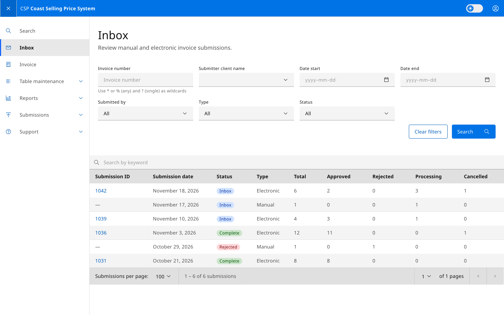
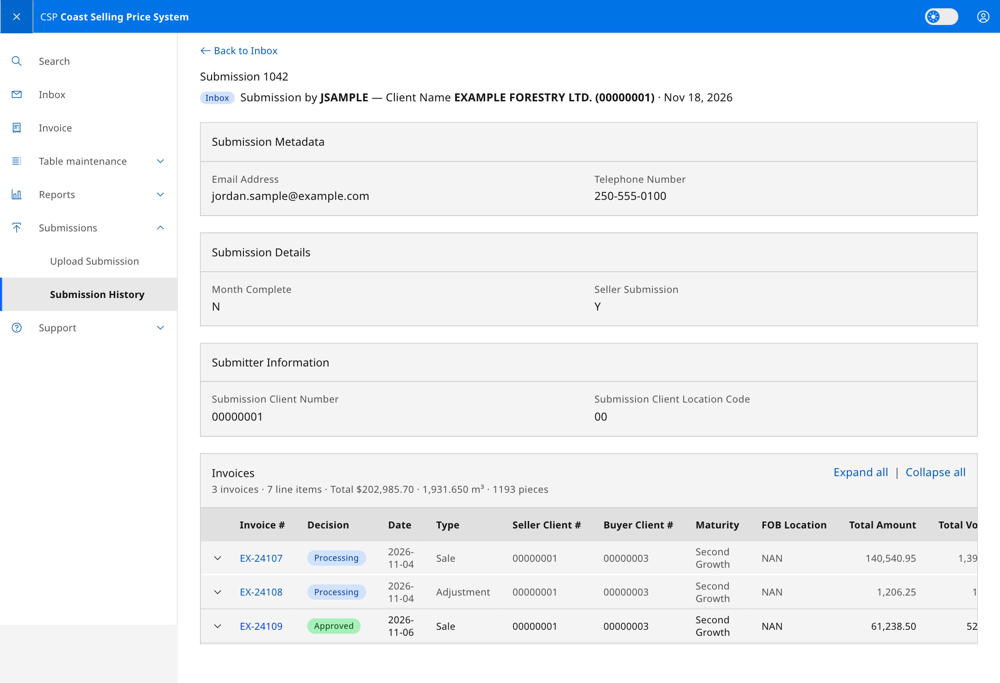

# 3. Inbox <!-- roles: admin, approver, viewer -->

The **Inbox** lists submissions: the XML files industry uploads and the
invoices staff enter, each with a count of its invoices by status. Use it to
see what is waiting for review and to open a submission's invoices.

## Screens

| Menu item | Use it to |
|---|---|
| **Inbox** | Find submissions and see how far their review has got. |

## Common tasks

### Find submissions waiting for review

1. **Inbox**.
2. Fill in any of the filters:

   | Filter | Finds |
   |---|---|
   | **Invoice number** | Submissions holding a matching invoice. Up to 15 characters; `*`, `%` and `?` work as in Search. |
   | **Submitter client name** | Submissions from that client. Type two letters and choose the client. |
   | **Date start** and **Date end** | Submissions received in that range, both days included. |
   | **Submitted by** | **Buyer** or **Seller**. |
   | **Type** | **Electronic** (an XML file) or **Manual** (entered by staff). |
   | **Status** | **Inbox**, **Lobby**, **Complete** or **Rejected**. See [Submission statuses](04-invoices.md#submission-statuses). |

3. Select **Search**. The newest submissions are first.

**Total** is the number of invoices in the submission. **Approved**,
**Rejected**, **Processing** and **Cancelled** count its invoices in each
status. Draft and unapproved invoices aren't counted in those columns.

### Open a submission and its invoices

1. Select the **Submission ID** of an electronic submission. The submission
   page opens with the contact details, client and month-complete flag from
   the file and a table of its invoices.
2. **Decision** shows each invoice's status. Select the arrow beside an
   invoice to see its details, line items and **Staff Comment**.
3. Select an **Invoice #** to open the invoice and review it. See
   [Invoices](04-invoices.md).
4. Select **Back to Inbox** to return to your results.

A manual submission shows **—** instead of a Submission ID. Find its invoice
with [Search](02-search.md).
