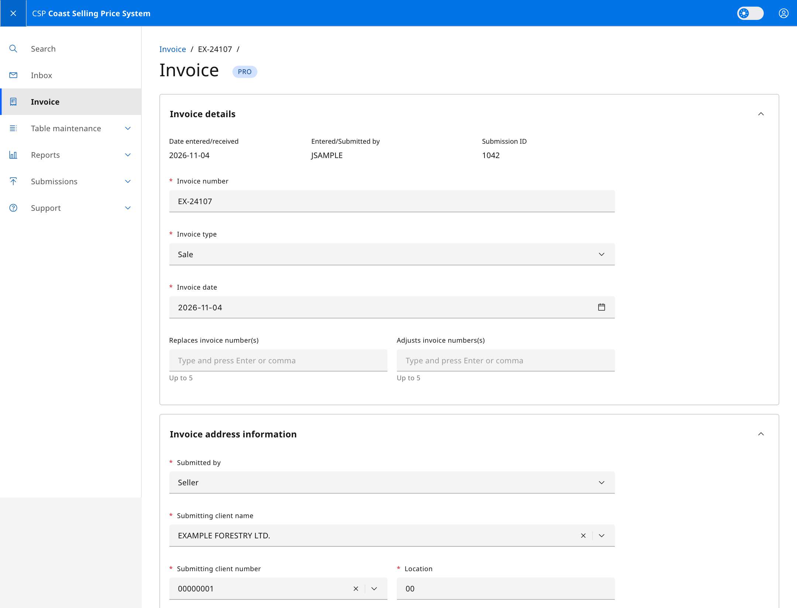
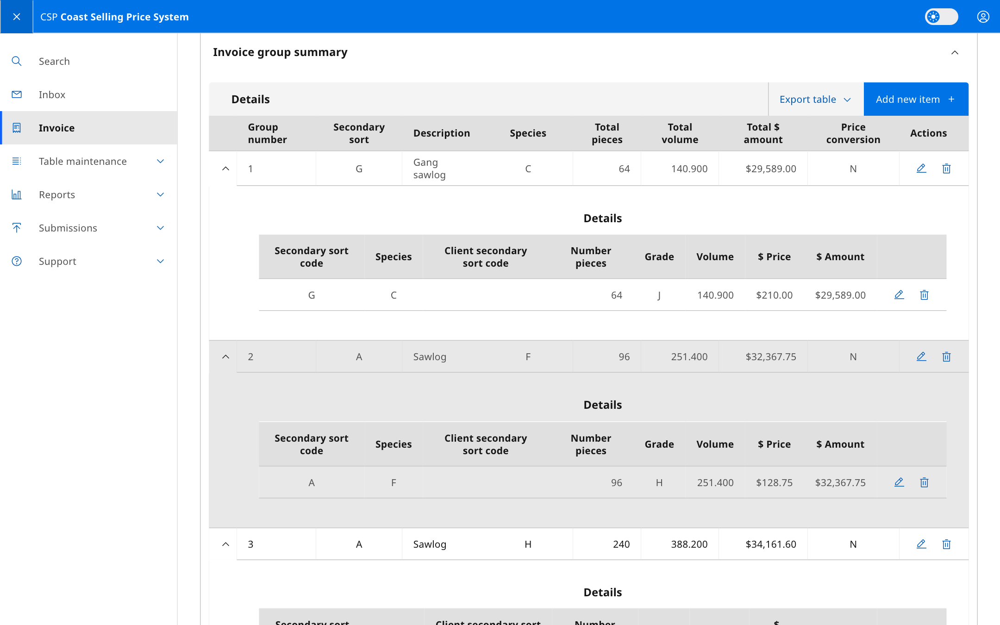
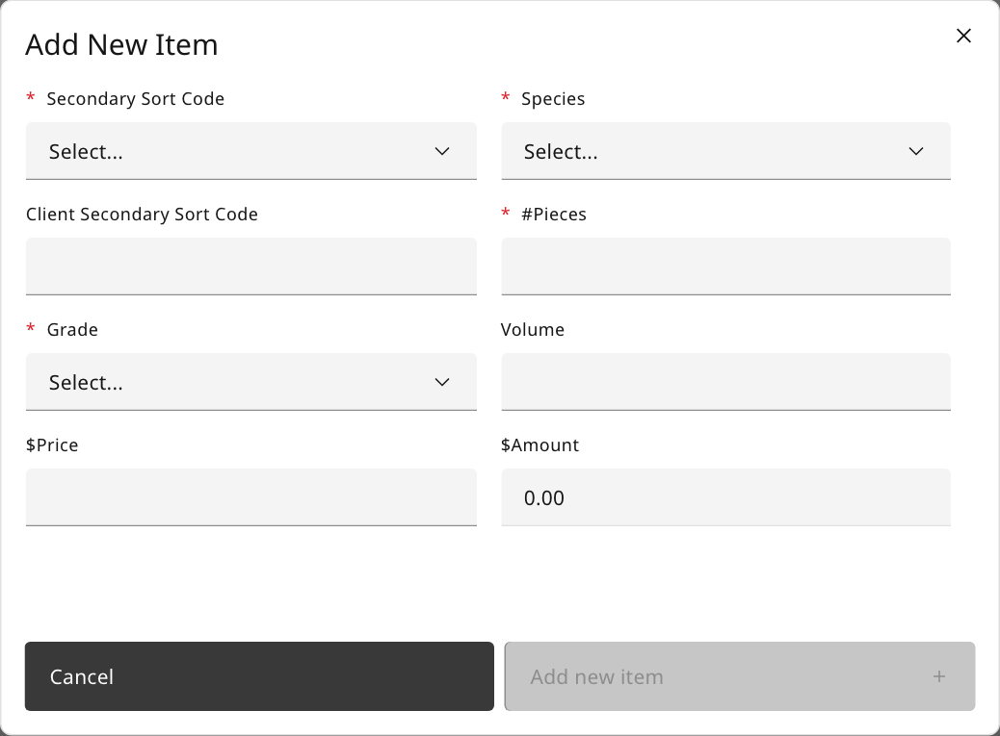

# 4. Invoices

An invoice records one log sale: who sold to whom, when, the maturity, the
source documents (boom numbers, timber marks or weigh slips) and a line for
each sort, species and grade with its pieces, volume and price. Invoices come
from industry XML files (electronic) or are keyed in by staff (manual).
Each one is reviewed and approved or rejected.

<!-- roles: data-entry -->
You enter manual invoices for industry invoices that arrive outside CSP, and
submit them for review. You can change a manual invoice while it is Draft or
Unapproved.
<!-- /roles -->
<!-- roles: viewer -->
You can open and read any invoice and export its group summary. You can't
change one.
<!-- /roles -->

## Screens

| Menu item | Use it to |
|---|---|
| **Invoice** | Enter a new manual invoice. | <!-- roles: admin, approver, data-entry -->
| **Search** | Find an invoice and open it. See [Search](02-search.md). |

## The invoice page

The tag beside the **Invoice** title shows the status code, for example
**PRO** for Processing. The page has four sections.

- **Invoice details**: when and by whom the invoice was entered or
  submitted, its **Submission ID** (**—** for a manual invoice), **Invoice
  number**, **Invoice type**, **Invoice date**, and the invoice numbers it
  replaces or adjusts.
- **Invoice address information**: **Submitted by** (**Buyer** or
  **Seller**), the submitting client and location, and the other party. City
  and province fill in from the client.
- **Invoice detail information**: **Maturity**, **FOB**, **Primary sort
  code**, the totals, **Boom numbers**, **Timber marks**, **Weigh slips**,
  **Client primary sort code** and the comments. **Reviewer comment** is the
  ministry's note; **Submitted comment** is the submitter's note from the XML
  file.
- **Invoice group summary**: the line items, grouped. It appears once the
  invoice is saved.

### Groups and line items

CSP groups the lines that share a secondary sort, species and price, and
numbers the groups. Each group row shows its totals and whether its prices
were converted (**Price conversion**). Select the arrow beside a group to see
its lines. **Invoice totals** at the bottom add up every line. A line's
amount is its volume times its price.

**Price conversion** is **Y** when CSP spread a single flat price over the
group's species and grades, using the flat price conversion table. CSP does
this when the invoice is saved or submitted. If the table has no factor for a
line, the invoice shows a warning.

For a manual invoice the header totals are always the sum of the lines. An
electronic invoice keeps the totals in its file.

## Common tasks

### Open an invoice

1. Find it with [Search](02-search.md) and select its number.
<!-- roles: admin, approver, viewer -->
2. Or open a submission from the [Inbox](03-inbox.md) and select an
   **Invoice #**.
<!-- /roles -->

Messages about the invoice show at the top: red **Validation error** boxes
and yellow warnings you can close.

<!-- roles: admin, approver, data-entry -->
### Enter a manual invoice

1. **Invoice**. The tag reads **New**. **Location** fields start at `00` and
   **Maturity** at Old Growth.
2. Under **Invoice details**, enter the **Invoice number** (uppercase
   letters, digits and hyphens, up to 15), **Invoice type** and **Invoice
   date**. To replace or adjust other invoices, type each number in
   **Replaces invoice number(s)** or **Adjusts invoice numbers(s)** and press
   Enter. Use one or the other, up to 5 numbers.
3. Under **Invoice address information**, choose **Submitted by**, then the
   submitting client by name or number (choosing one fills the other) and
   its **Location**. Then choose the other party the same way.
4. Under **Invoice detail information**, choose **Maturity** and enter the
   **FOB** location. Enter at least one **Boom numbers**, **Timber marks** or
   **Weigh slips** entry: type it and press Enter.
5. Select **Save**. The invoice is saved as Draft and CSP reminds you to
   submit it.
6. Add the line items. See the next task.
7. Check the groups and totals, then select **Submit**. The invoice moves to
   Processing for review.

**Save** stays greyed out until every required field (\*) is filled, the
other party is chosen and there is at least one boom number, timber mark or
weigh slip.

CSP warns you, without stopping you, if the invoice number already exists or
the month is already completed. It refuses an invoice dated in the future, a
seller reporting a purchase or a buyer reporting a sale.

### Add, change and delete line items

1. Save the invoice first.
2. Select **Add new item**.
3. Enter **Secondary Sort Code**, **Species**, **#Pieces**, **Grade**,
   **Volume** and **$Price**. The species and grade lists only offer valid
   combinations, and **$Amount** is calculated.
4. Select **Add new item** in the dialog.

- To change one line, select its pencil icon, edit the row and select the
  save icon.
- To change the secondary sort or species of a whole group, select the
  group's pencil icon (**Edit group**).
- To delete a line or a whole group, select its bin icon and confirm.

Any change to the lines puts the invoice back to Draft, so submit it again
afterwards.
<!-- /roles -->

<!-- roles: data-entry -->
You can change a manual invoice only while it is Draft or Unapproved. Once it
is submitted, its buttons are greyed out for you until a reviewer unapproves
it.
<!-- /roles -->

<!-- roles: admin, approver -->
### Review and approve an invoice

1. Open the invoice.
2. Check the details, the groups and lines, and any warnings.
3. Select **Approve**.

You can't approve an invoice you entered yourself. **Approve** works on
Processing and Unapproved invoices.

### Reject or cancel an invoice

1. Type the reason in **Reviewer comment**. It must differ from the comment
   already saved.
2. Select **Reject**, or **Cancel** to withdraw the invoice.

Both need a reviewer comment and work on Processing and Unapproved invoices.
**Cancel** cancels the invoice; it doesn't discard your edits. Rejected and
cancelled invoices are final.

### Unapprove an invoice

1. Open the approved invoice.
2. Type the reason in **Reviewer comment**.
3. Select **Unapprove**. The invoice becomes Unapproved and can be changed
   and submitted again.

### Change an invoice under review

Change any field and select **Save**. A Processing or Unapproved invoice goes
back to Draft when saved, so select **Submit** again when you're done.

### Duplicate an invoice

Select **Duplicate** on a Draft, Processing or Unapproved invoice. A Draft
copy opens, with the same number and lines, in the same submission. Change
the invoice number if needed, then save.

### Delete an invoice

1. Open a Draft or Processing invoice.
2. Select **Delete**, then **Delete** in **Delete invoice**.

The invoice can't be recovered. CSP opens a blank invoice afterwards. To
delete an approved invoice, unapprove it first.
<!-- /roles -->

<!-- roles: admin, approver, viewer -->
### Export the group summary

1. In **Invoice group summary**, select **Export table**.
2. Choose **Export to CSV** or **Export to PDF**. The file downloads.
<!-- /roles -->

<!-- roles: admin, approver, data-entry -->
### If someone else changed the invoice

If another user changed the invoice after you opened it, CSP refuses your
change and shows **This invoice was changed by another user after you opened
it.** Reload the page to see their changes, then make yours again.
<!-- /roles -->

## Buttons

Buttons your role or the invoice's status doesn't allow are greyed out.

| Button | Works when the invoice is |
|---|---|
| **Save** | New, Draft, Processing or Unapproved | <!-- roles: admin, approver, data-entry -->
| **Submit** | Draft or Unapproved, saved, with at least one line item | <!-- roles: admin, approver, data-entry -->
| **Approve** / **Unapprove** | Processing or Unapproved / Approved | <!-- roles: admin, approver -->
| **Duplicate** | Draft, Processing or Unapproved | <!-- roles: admin, approver -->
| **Cancel**, **Reject** | Processing or Unapproved, with a reviewer comment | <!-- roles: admin, approver -->
| **Delete** | Draft or Processing | <!-- roles: admin, approver -->
| **Add new item** | Saved and not Approved | <!-- roles: admin, approver, data-entry -->
| **Export table** | Saved | <!-- roles: admin, approver, viewer -->

## Invoice statuses

| Status | Means |
|---|---|
| **Draft** (DFT) | Being entered or changed. New manual invoices, uploaded invoices and duplicates start here. |
| **Processing** (PRO) | Submitted and waiting for a decision. |
| **Approved** (APP) | Accepted. |
| **Rejected** (REJ) | Not accepted. Final. |
| **Cancelled** (CAN) | Withdrawn, or replaced by another invoice. Final. |
| **Unapproved** (UNA) | An approval was reversed. It can be changed and submitted again. |

Saving an invoice that replaces others cancels the originals.

## Submission statuses

Every invoice belongs to a submission: an uploaded XML file, or a manual
entry.

| Status | Means |
|---|---|
| **Lobby** | A manual invoice is being entered, or an invoice was saved or changed and not yet submitted. |
| **Inbox** | Waiting for review. Uploads arrive here, and submitting an invoice returns its submission here. |
| **Complete** | Review is finished and at least one invoice is approved. |
| **Rejected** | Review is finished and no invoice is approved. |
