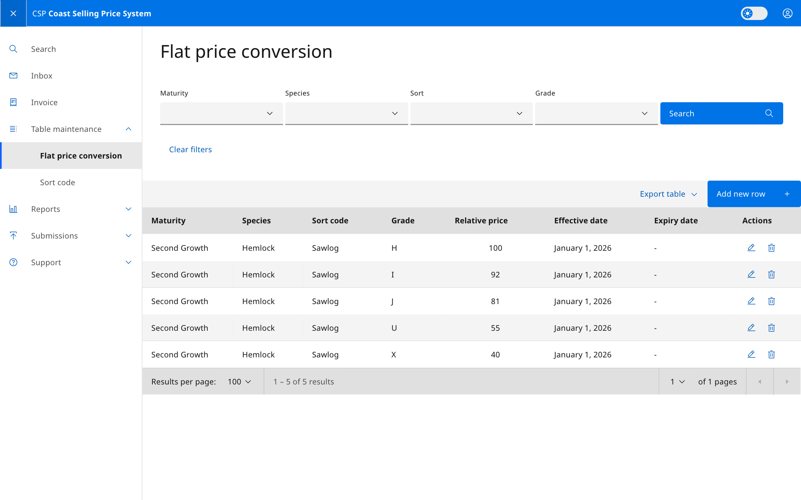
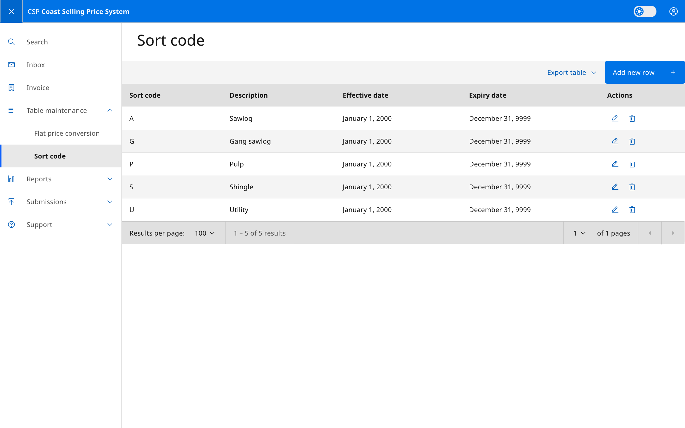

# 5. Table maintenance <!-- roles: admin, approver, viewer -->

CSP keeps two reference tables. The **sort code** table lists the log sale
sort codes used on invoices. The **flat price conversion** table holds the
relative prices CSP uses to spread a single flat price across the species and
grades in a sort.

<!-- roles: approver, viewer -->
You can search, view and export both tables. Only an Admin changes them.
<!-- /roles -->

## Screens

| Menu item | Use it to |
|---|---|
| **Table maintenance › Flat price conversion** | Find, export and maintain relative prices by maturity, species, sort and grade. |
| **Table maintenance › Sort code** | See, export and maintain the sort codes. |

## How flat price conversion works

Sellers sometimes invoice several species and grades in one sort at a single
flat price. When such an invoice is saved, CSP gives each line a converted
price in proportion to its **Relative price** in this table, weighted by
volume, so that the lines still average back to the flat price. CSP uses the
row for the invoice's maturity, sort, species and grade that is in effect on
the invoice date. Mixed growth invoices use the old growth rows.

## Common tasks

### Find flat price conversions

1. **Table maintenance › Flat price conversion**.
2. Choose any of **Maturity**, **Species**, **Sort** and **Grade**.
3. Select **Search**.

The results include expired rows. **Expiry date** shows **-** for a row with
no end date.

<!-- roles: admin -->
### Add a flat price conversion

1. Select **Add new row**.
2. Choose **Species**, then **Sort**, **Grade** (it lists the chosen
   species' grades) and **Maturity**.
3. Enter **Relative price**, a whole number from 1 to 999, and **Effective
   date**. **Expiry date** is optional.
4. Select **Save**. CSP shows **Row added successfully.**

CSP refuses a row whose sort code or maturity isn't active on the effective
date, a species and grade that don't go together, or a row that already
exists.

### Change or retire a flat price conversion

1. Search for the row and select its pencil icon (**Edit**).
2. Change any field and select **Save**.

To change a price from a date, set **Expiry date** on the current row and add
a new row with the new **Effective date**.

### Delete a flat price conversion

Select the row's bin icon (**Delete**), then **Delete** in **Delete row**. The
row can't be recovered.
<!-- /roles -->

### See the sort codes

**Table maintenance › Sort code** lists every sort code with its
**Description**, **Effective date** and **Expiry date**. There is nothing to
search: the whole table shows, in code order.

<!-- roles: admin -->
### Add a sort code

1. Select **Add new row**.
2. Enter the **Sort code** (one letter), **Description** (up to 120
   characters), **Effective date** and **Expiry date**.
3. Select **Save**. CSP shows **Sort code '…' created.**

### Change or delete a sort code

- Select the pencil icon to change the **Description** or dates. The code
  itself can't change.
- Select the bin icon, then **Delete**, to delete a sort code. It can't be
  recovered.
<!-- /roles -->

### Export a table

1. On **Flat price conversion**, search first; the export holds the rows the
   search found. **Sort code** exports the whole table.
2. Select **Export table**, then **Export as CSV** or **Export as PDF**. The
   file downloads.
