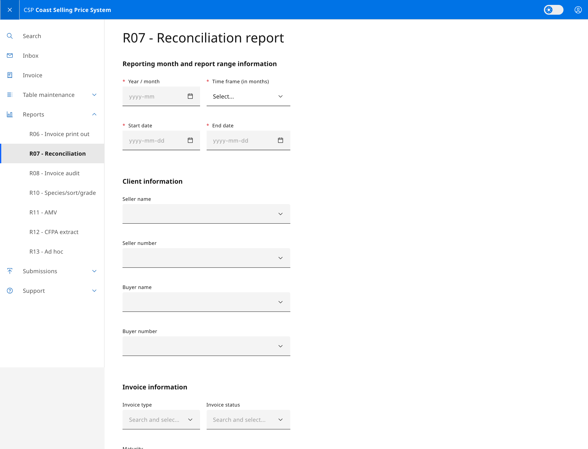

# 6. Reports <!-- roles: admin, approver, viewer -->

CSP produces seven reports, each as a PDF or a CSV file. Choose the report in
the menu, set its options and select **Generate PDF** or **Export CSV**. The
file downloads.

## Screens

| Menu item | Use it to |
|---|---|
| **Reports › R06 - Invoice print out** | Print complete invoices, with their groups and line items, for a date range or for invoice numbers. |
| **Reports › R07 - Reconciliation** | Compare each invoice's original and new volume and amount after replacing or adjusting invoices, for a reporting month or a period. |
| **Reports › R08 - Invoice audit** | List invoices by maturity and type with totals per submission, to check against control totals. |
| **Reports › R10 - Species/sort/grade** | Summarize log sales by species, sort and grade: volume, share, pieces, $/m³ and value. |
| **Reports › R11 - AMV** | Show average market values ($/m³) by species and grade for a period. |
| **Reports › R12 - CFPA extract** | Extract every invoice line for a year, a month or a date range. |
| **Reports › R13 - Ad hoc** | Build your own invoice report: choose the filters and the columns. |

## Options all reports share

- **Start date** and **End date** set the period. Choose a **Time frame** in
  months instead of an end date and CSP fills in **End date**: the last day of
  the month that many months on, counting the start month. Typing an end date
  clears the time frame.
- Client names suggest clients after two letters; choose one from the list.
  Choosing a name fills the matching number, and the other way round.
- A list you leave empty, such as **Maturity**, means all values.
- **Clear all** empties every option.
- While the report runs, the buttons read **Generating...**.
- If nothing matches, CSP shows **No data found. No records matched the
  selected criteria.** Problems with your options show under the field or in
  a red **Validation error** box at the top.

A red asterisk on several fields of R07, R08 and R12 means one of them is
needed, as listed below, not all of them.

## Common tasks

### Print invoices (R06)

1. **Reports › R06 - Invoice print out**.
2. Either enter **Start date (report range)** and **End date (report
   range)**, or under **Add invoice number range** enter invoice numbers in
   **From** and **To**. Fill in only **From** for a single invoice; select
   **Add another range** for more.
3. Narrow by **Maturity**, seller, buyer, **Submission number**, **Invoice
   status** or **Invoice type** if you need to.
4. Select **Generate PDF**.

Each invoice prints with its summary, its groups and its line items.

### Reconcile a month or a period (R07)

1. **Reports › R07 - Reconciliation**.
2. Enter at least one of: the reporting **Year / month**, a **Start date**
   with an **End date** or **Time frame (in months)**, a seller or buyer, or a
   **Submission number**.
3. Narrow by invoice type, status, maturity or submission status if you need
   to. Tick **Replaces / Adjust** to show the replacing and adjusting invoice
   numbers.
4. Select **Generate PDF** or **Export CSV**.

The report groups invoices by maturity and client and shows each invoice's
original and new volume and amount, with adjusted totals at the end.

### Audit invoices (R08)

1. **Reports › R08 - Invoice audit**.
2. Enter at least one of: a **Start date** with an **End date** or **Time
   frame (in months)**, a **Submission number**, or the submission **Year /
   month**.
3. Narrow by invoice type, status, maturity, seller or buyer if you need to.
4. Select **Generate PDF** or **Export CSV**.

### Summarize by species, sort and grade (R10)

1. **Reports › R10 - Species/sort/grade**.
2. Enter **Start date** and an **End date** or **Time frame**. The report
   covers whole months, from the first day of the start month to the last day
   of the end month.
3. Narrow by **Seller name**, **Buyer name**, **Invoice type** or
   **Maturity** if you need to.
4. Select **Generate PDF** or **Export CSV**.

### Average market values (R11)

1. **Reports › R11 - AMV**.
2. Enter **Start date** and an **End date** or **Time frame**.
3. Choose **Report type**: **Production**, or one of the scenarios.
4. Choose **Maturity** if you need to. Tick **Blended** to combine the chosen
   maturities in one section instead of one section each.
5. Select **Generate PDF** or **Export CSV**.

### Extract invoice lines (R12)

1. **Reports › R12 - CFPA extract**.
2. Either choose a **Report year** (and a **Report month** for one month), or
   enter **Start date** and an **End date** or **Time frame**. Dates cover
   whole months.
3. Choose **Maturity** if you need to.
4. Select **Export CSV** or **Generate PDF**.

### Build an ad hoc report (R13)

1. **Reports › R13 - Ad hoc**.
2. Under **Report information**, enter a **Report name**, **Start date** and
   an **End date** or **Time frame (months)**.
3. In each section, enter a value in the **Filter** column to narrow the
   invoices, and tick **Show on report** for each field to show as a column.
   The two are independent. Tick at least two columns.
4. In the range rows (invoice number, boom number, timber mark and weigh
   slip), use **From** and **To**, or leave one empty for an open range. In
   the boom number, timber mark, weigh slip and replaces/adjusts value boxes,
   `%` matches any characters.
5. Tick any **Additional columns**, such as pieces, volume, amount, prices or
   comments.
6. Select **Generate PDF** or **Export CSV**.

The report title includes your report name, and its header lists the filters
you used.
