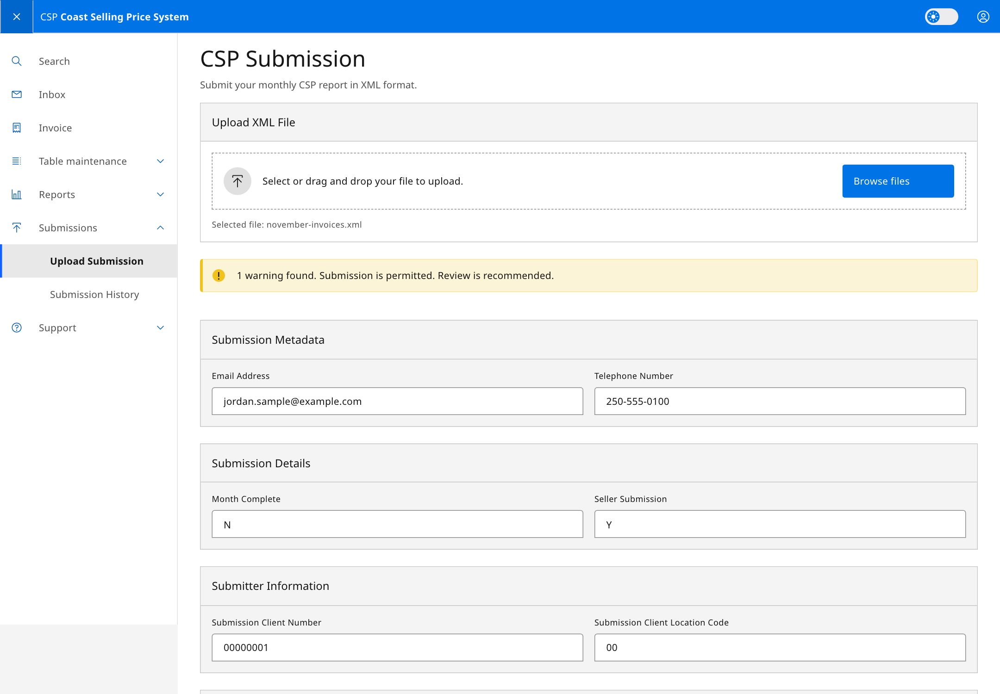

# 7. Submissions <!-- roles: admin, approver, viewer -->

Industry users send their invoices as XML files from **Submissions › Upload
Submission**. Staff can upload a file the same way, for any client, for
example one that arrived by email. **Submission History** lists every
submission.

## Screens

| Menu item | Use it to |
|---|---|
| **Submissions › Upload Submission** | Upload an XML file of invoices for a client, check it and submit it. |
| **Submissions › Submission History** | See every submission, its status and the staff comments on its invoices. |

## Common tasks

### Upload a file for a client

1. **Submissions › Upload Submission**.
2. Select **Browse files** and choose the `.xml` file, or drag it onto the
   box.
3. CSP checks the file's structure, then its content against CSP's rules,
   and shows the result: no issues, warnings (you can submit) or errors
   (**Submit** stays off).
4. Check the fields CSP read from the file. You can correct **Email
   Address**, **Telephone Number**, **Month Complete**, **Seller Submission**,
   **Submission Client Number** and **Submission Client Location Code**.
5. Under **Invoice Details**, select the arrow beside an invoice to see its
   issues, details and line items.
6. Select **Submit**. CSP opens the new submission. Its status is **Inbox**
   and its invoices are Draft.

CSP saves the whole file or none of it: one invoice with an error stops the
file. If the file isn't valid XML in the CSP format, CSP lists the problems
with their line and column; **Download issues (.csv)** saves the list. The
invoices can't be changed on screen, so ask the client for a corrected file.

### Follow a submission

1. **Submissions › Submission History**. The newest submission is at the top.
2. Select the arrow at the start of a row to see each invoice's status and
   reviewer comment.
3. Select the invoice count, or the eye icon (**View submission**), to open
   the submission and its invoices.

A manual submission has no link: find its invoice with
[Search](02-search.md).

<!-- roles: admin, approver -->
### Review the invoices of a new upload

An uploaded file's invoices are Draft. To start the review, open each
invoice and select **Submit**, which moves it to Processing. See
[Invoices](04-invoices.md).
<!-- /roles -->
